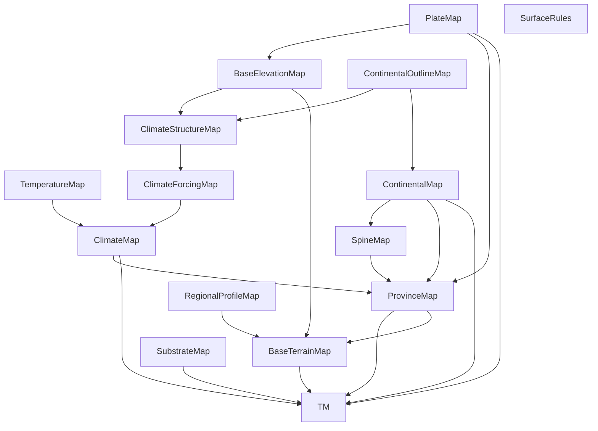
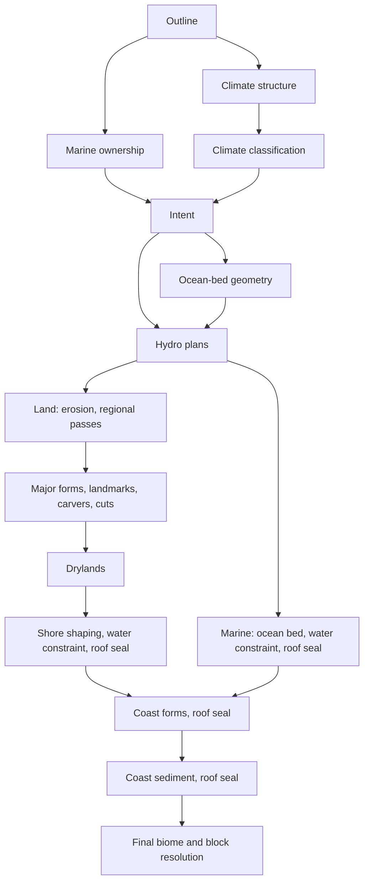

# Architecture

How Riven generates terrain (`TerrainMap.VERSION`, logged at startup). Feature details are in [FEATURES.md](FEATURES.md);
the runtime stack is in [RUNTIME.md](RUNTIME.md); version history is in
[CHANGELOG.md](../CHANGELOG.md).

## Determinism contract

Generated geometry is a pure function of the world seed, the packaged definitions
(`src/main/resources/riven-*.json`) and the world's layout scale (`WorldScale`, from the
generator options level.dat saves; blank means 1). Final block states and biome colors also use
the world's resolved definitions snapshot. Request order, thread count, cache state and eviction must
not change any result. Memos publish immutable decisions through atomic references; concurrent
misses may duplicate cold work but cannot produce different values. An evicted entry rebuilds as
a new object equal to the old, so a value that refers to another memo's entries compares them by
key, never by reference (`Shore.Segment.is`: a coast form keeps its segment while the segment memo
may rebuild it). Memos with a `SharedBuild`
(every `CellMemo` and hydrology plans) give concurrent misses on one key
a single build, which publishes its value before it lets go of the key and first looks for the
value again, so a miss that raced a build ending finds the value instead of building it again.
In-build parallelism (drainage scans, network and plan builds) runs through `BuildPool` on the
host's bounded pool (Cubature's build pool in the game, a shared bounded pool in tools) or on the
calling thread, never the JVM's common pool; the caller always works its own loop, so a bounded
pool cannot deadlock on a single build. At world load `RivenWorldType` requests Cubature's pool
before constructing the biome provider and passes it through `WorldGenerationContext` to
`GenerationMaps`, so the climate coverage and the spine tiles it needs already use the host's
pool. The cube provider later adopts the same pool; Cubature owns shutdown. Failed map or biome
provider construction releases its own resources. Riven's failure cleanup abandons a completed
pool request only when no other pending or live construction owns it.
Preview columns build on their own thread alone
(`BuildPool.alone`): a distant preview tile can start regional builds native generation needs
much later, and on the shared pool those would hold the helpers native builds wait for. Cubature also prepares regional plans ahead of the
players through `ICubeGenerator.prepareRegion` ("Preparation within bounds" in DECISIONS.md):
`TerrainMap.prepareRegion` builds one hydrology owner cell's drainage networks and plan, then its
coast forms and sediment, and declines once a memo would pass its headroom: a quarter of a
set-associative memo, half the drainage memo, or 10 MB x layout squared of networks. A `CellMemo`
keeps each cell in either of two slots and a miss replaces the older entry, so cells no longer read age out and
two cells sharing a slot do not rebuild each other on every read (with a fixed victim, two
continents' drainage networks did, and a 16 km check on seed 5 ran for hours). A drainage query
takes the continents whose support reaches the column, then builds only those with an own cell of
their network grid within the query's reach plus a bound on how far a channel strays from its
cells (the largest meander offset and three cells). Each continent's own cells come from the same
continental samples its network reads, so a skipped network could not have answered;
`tools/checks/DrainagePruneCheck` compares answers with and without the skip. The terrain
atlas proves this per render: `tools/terrain_atlas.py render --verify` re-samples in reverse
order on a different thread count and requires an identical SHA-256 digest of every layer and
site decision. Samples are reused per thread, so each stage result registers with
`TerrainMap.Sample` where it is declared, by the phase that runs it, and every column clears the
stages it skips in one call; `tools/checks/SampleHistoryCheck` proves a reused sample equals a
fresh one.

Each definition carries a fingerprint that fresh instances record. Changing a definition, a
composition order, a tie-break or a loop order at a budget limit changes worlds and needs a fresh
instance.

## Derived regional storage

The kept climate draw's `Drainage` checks its bounded memory memo first. On a miss, the existing
single-flight computation rechecks the memo, then tries a verified regional file before the pure
build and a cache write on that builder's thread. The store is bound after climate selection and
before the context is published. Hydrology plans and the other regional services retain their
memory memos. Public tools constructors, the ordinary atlas and no-store goldens are memory-only;
dedicated storage checks opt in explicitly. Stored maps require the standard terrain-height
reference.

`RegionalIdentity` freezes the complete packaged definition catalogue before use. The seed,
exact layout bits and terrain version join those fingerprints in the namespace; each file also
verifies its kind, region key, format and codec versions, full identity and body checksum.
Geometry reads the packaged rules; world-resolved block bindings and biome colors are applied
outside this stored graph. Missing, stale, malformed or unreadable files are misses. Cache-write
failures leave the computed value usable, while unexpected codec failures propagate.

The flat drainage layout preserves channel and bin order, nullable arrays, lake fields and raw
floating bits. A read maps the file through a confined FFM arena, reconstructs an immutable heap
graph and closes the arena before publishing it. The graph retains no mapped segment or entry
from another memo. Writers force a temporary file and atomically rename it; concurrent writers
of one key publish identical content. Riven starts no storage threads.

Cubature supplies the cache root beside the save. The `WorldServer` factory uses a separate token
per construction, with its own store handle when the host directory is non-null. A failure
releases only that construction's resources. World unload terminates that world's ownership,
while server stop closes the server epoch's stores. Late results release their detached handles.
The factory and selected pool abandonment run on the server thread; terminal unload cleanup
also accepts the shutdown hook. Store closure and host callbacks run outside ownership locks.
A null host directory leaves generation on its memory-only path.

Demand fills the persistent tier and files remain until removal. Memory hits perform no storage
work, so they do not retry failed writes or recreate deleted files. A later memory miss can
rebuild and store the same value.

## Entry points

| Path | Caller | What it samples |
| --- | --- | --- |
| `RivenWorldType.Generator.generateCube` | Cubature, native cubes | One `NativeColumns` entry per chunk column: `TerrainMap.sample` once per column, assembled by the column engine and stored as its runs of blocks and roles, read by every cube between the lowest soil and the reference top (Y 351); cubes wholly under the ground also read each 4x4x4 cell's depth biome from the entry |
| `RivenWorldType.Generator.generateColumn` | Cubature, biome arrays | The same `NativeColumns` entry's habitats |
| `RivenWorldType.Generator.prepareRetainedColumn` | Cubature generation workers, held arrivals | Retains the immutable `NativeColumns` entry until the host installs the destination column or releases the last arrival |
| `RivenWorldType.Generator.cubeClass` / `surfaceBand` | Optional host capability (`ICubeClassification`) | Loaded bounds and completed memo or retained columns, including required neighbours; missing required facts yield `UNKNOWN` or no surface band |
| `createTerrainPreviewSampler` | Cubature DH provider | `TerrainMap.sample` per preview column, assembled by the column engine and emitted as its runs |
| `ClimateBiomeProvider` | Minecraft biome queries | `surfaceHabitat`; spawn biomes exclude ocean, deep ocean, river, swamp and all three beach biomes |
| `RivenSpawn` | Forge `CreateSpawnPosition` | First dry land column, in 64-block rings out to 16,384 blocks, with a 16-block dry margin |
| `/riven` (`RivenCommand`, report in `ColumnReport`) | Player | All observations at the player's column |

Cubes entirely below the lowest possible soil are filled with stone directly unless an aquifer
intersects them; cubes above the highest possible surface are air. `NativeColumns` holds
resolved chunk columns in a set-associative cache (`nativeColumnCache` in `riven-terrain.json`,
1,024 entries, about 8 MB) of immutable entries, so a column is sampled once rather than once per
cube. Held arrivals use the optional `IRetainedColumnPreparation` contract: a worker reserves one
immutable column independently of ordinary memo eviction, and every column lookup checks those
reservations first. Overlapping reservations share their value and release it after the last owner
closes. Cubature bounds the held keys and owns release after installation, replacement, departure or
shutdown, including a worker finishing an abandoned request. Builds run outside reservation-map
locks; an ordinary same-key build in flight cannot block a lookup of a prepared reservation.

Completed entries also record their highest native non-air top, conservative raw geometry bounds
and logical ground kinds. `ICubeClassification` combines these with loaded boulder, tree and
ground-cover limits and completed neighbouring entries. Queries use only already-held memo or
retained values and never build, load, prepare or wait for missing data. `EMPTY` certifies that
ordinary generation into a fresh primer produces only air and no 3D biome entries. Missing
required summaries or unsupported feature reach yields `UNKNOWN`; `DETAILED` and `UNKNOWN`
require ordinary generation. The optional inclusive cube-Y `surfaceBand` covers generated
surface ground, fluids and decorations, or is absent when its bounds cannot be proved.

Surface and water queries (`NativeColumns.surface` for tree sites' clearance,
`NativeColumns.water` for reeds beside water) read a held chunk column or resolve just their one
column, with a small per-thread cache, so distant previews do not build whole chunk columns for
them. Clearance only asks whether a column rises above a height (`NativeColumns.surfaceAbove`):
carving never raises a column's top, so the uncarved runs settle most answers and only the rest is
carved. Population asks the same way whether a cube holds its anchor column's surface, so a sky
cube beside cubes loaded from disk (a pregenerated world) does not build a cold chunk column on
the server thread. `tools/checks/SurfaceQueryCheck` proves the queries equal the chunk column's and the bound
holds. Blocks come from the catalogue (`riven-catalogue.json`): every block the generator places
is one `TerrainBlock` entry, its id prefixed by its kind
(`rock.gabbro`), with tags and candidate states of which the first registered wins, so later
candidates are the stand-ins. Definitions name entries by id; the generator's code names the
vanilla, soil, decoration and formation entries it needs as `TerrainBlock` constants.
`TerrainColumn` resolves each entry to its Minecraft state. Until the remaining Java block rules
move into the catalogue, startup also builds the former hard-coded table and fails on any
difference, and logs which entries resolved to a stand-in. Population (FEATURES.md, "Population") spawns a chunk's first animals and writes no block, so no
content depends on the order cubes populate in.

## Map graph

`GenerationMaps` (one per seed, owned by `WorldGenerationContext`) builds every service once:

Dependencies run one way. Earlier services never read later ones; no service reads final
terrain to make a selection.

## Planning boundaries

`TerrainMap` exposes five boundaries. Planners read only the boundary their contract names;
they never call `surfaceHabitat` or final `sample`.

| Boundary | Available facts | Excluded |
| --- | --- | --- |
| `intent` | Outline, marine ownership and ocean water, climate and the province (effective climate), base terrain, shore intent | Local hydrology, all shaping |
| `habitat` | Intent plus local surface-water and lens plans | Final terrain, coastal emergence |
| `sampleBeforeMajorFeatures` | Habitat, erosion, regional passes; constrained ocean bed on marine columns | Major forms, carvers, drylands, coastal formations |
| `sampleBeforeRocky` | Complete earlier surface with shore/water constraints and roof seal | Coast forms |
| `sampleBeforeSediment` | The above plus the coast's forms and roof seal | Coast sediment |

Major-form certificates read `sampleBeforeMajorFeatures` on the shared site-certificate lattice
(every 8 blocks, world-aligned, since v56) over their support plus an anchor and halo, so a site
decision costs the same whatever resolution a native cube or a DH tile requests; the coast's forms read their facts from `sampleBeforeRocky` and its
sediment from `sampleBeforeSediment`. `surfaceHabitat` is for final biome consumers and runs
final shaping where a native coastal plan exists.

## Composition order

Land columns run, in order: erosion, regional passes, volcanic, cold,
mountains, regional landmarks, surface carvers, general surface cuts, drylands, shore
shaping, hydrology constraint, coast forms, coast sediment. Marine columns run ocean bed,
hydrology constraint and roof seal, then the coastal stages. This order is part of the generator
definition:

- `Sites` prevents major supports from stacking. Each winner is decided from seeded raw
  neighbors with a coordinate tie-break; rejected winners leave empty space.
- Lowland and dryland alternatives read one common parent within their stage; ocean ridge,
  trench and bank alternatives read the same shelf parent. These are compositions, not erosion
  simulations.
- Drylands read the applied major and cut results to attenuate their detail.
- Shore shaping precedes the hydrology constraint. Later coastal plans certify their parents and
  preserve water reservations; reapplying all constraints afterwards would change them.
- Roof sealing clips a lake (lens) interval conservatively; a later raised surface does not
  recreate removed water.
- After the geology column, each sample reads its flood cell (`FloodMap`), then its cave
  entrances. A flood cell's level comes from its center's sample up to the geology column, which
  reads neither flood cells nor caves, so no sample depends on itself.

Within `Hydro`, construction runs network and lake, supplemental basins, expanded coastal
decisions, lens, then river decisions, so rivers see completed coastal reservations. Sampling
applies the lens, network/lake/river, then basins; later bodies keep existing wet ownership.

## The column engine

`worldgen.engine` assembles each column's crust once, as runs of `bottom`, catalogue entry, role
and zone (`AssembledColumn`), for native cubes, the distant preview, the one-column queries and
`/riven` alike. It is Minecraft-free; `TerrainColumn` maps entries to states. Definitions are read
once (`Assembly`): the zone tree in `riven-zones.json` and the setting thresholds and tables in
`riven-surface.json`. The crust runs from the reference top to the crust floor, with one cavity,
the sky, whose roof band (8 blocks, 16 where the column is wet) no carve but an entrance cuts. Its
sub-zones, the first that holds winning, are the root at and below geology's deep surface, the
surface band (the 8 blocks from the ground down), the skin (to 40 blocks down) and the body
between; runs split at their bands and carry the sub-zone as their zone. A zone's boundaries are
fixed Ys, depths below the ground or horizons the shape publishes (the ground and the ground
under deposits, the water, an aquifer's pocket, geology's deep surface, lava level and
unconformity, a flood cell's band).

An `Assembler` runs fixed passes, each writing half-open intervals by splitting runs, so cost
follows a column's transitions:

1. **Shape** (`CrustShape` over the terrain sample): raise the ground to the sky's floor (for a
   coast form with a volume, the ground before it); lay sediment over it; build a stack's or
   arch's solid and carve an arch's tunnel or a sea cave; open the aquifer as a pocket; then
   the caves. `CaveMap` walks a native column bottom-up, each block taking the first of the carve
   forms its sub-zone allows that opens it (`CaveMap.FORMS`: chamber rooms in magma alone,
   fissures, lava tubes, the root's geodes, lava rivers, pillar halls and tunnels, the basement's
   caverns, joint mazes, vein galleries and tunnels, the layered rock's caverns, tunnels, karst,
   bedding planes, domes and salt halls). Its voids, linings, pools and decorations enter the shape
   as caves under the roof band, entrances whole.
2. **Materials:** the classifier (`CrustSettings`) says which settings hold at the floor, the
   cavity's table picks the first in its order, and its top, soil and subsoil layers are written
   over raised rock, counted down from the floor. A row without a subsoil takes the next holding
   row's.
3. **Bed:** bed runs take their rock from the zone's bed source (`CrustStrata`: geology and its
   tint bands).
4. **Fills:** open space takes its cavity's fluid up to its level (water to the water horizon), a
   pocket its own level, and air above. Carved caves take theirs by a fixed precedence
   (`CaveFills`, D15): lava up to the lava horizon, then an aquifer's water to its level, then a
   cave pool, then a flood cell's band, then air; water freezes where the void's (or pool's) depth
   biome is frozen. Cave dressing (pools, seeps, decorations) reads the same precedence before
   assembly.

What a pass may write over is the engine's rule (`Shape.Pass`): built rock is never carved, caves
never cut a coast form's void, a pocket only opens raised or laid ground, and materials touch
raised rock only. `tools/checks/AssembledColumnCheck` proves runs cover the crust, `at` and `role`
agree with them, columns are equal cold, from reused buffers and in reverse order, soil roles lie
only in their layer and every role is legal for its pass, that every carved block's family comes
from a form its sub-zone allows, the roof band holds but at entrances and carved space is filled
by the precedence, and that native chunk columns store exactly the assembled runs. The native cube writer then swaps rock for content where the column
says so: an ore body's ore first (only below the top of the column's highest bed run), else the
host rock's unstable stone on an unstable floor; the distant preview keeps the rock. Realms keep
their own cube path below the crust floor.

## Feature sites

`Sites` (configured in `riven-terrain.json`) places sparse major features on a 288-block cell
grid (terrain-v130: one mode). Each lane (landmark, carver, general cut, cold, volcanic) draws its
own anchor in every cell from a lane-salted key with its `laneDensity`; the salts are stable, so a
lane leaving changes no other lane's anchors. An anchor is admitted only if no higher-priority
anchor of its own lane, whose own anchor-local admission passes (earlier facts, memoized per
cell), lies within twice that lane's radius; supports of different lanes may overlap and compose
in stage order. Per-lane maximum radii: carver, cut, landmark 259; volcanic 288; cold 816 blocks.

Each family's terrain adapter then certifies its admitted site against the earlier parent and
rejects it when the footprint fails, without rerolling. Mountains stand on no site: since
terrain-v130 their plans sit at nodes along the continents' spines (`SpineMap.nodes`), and the
retired continent crests and the shared-competition mode are gone.

## Measured structural limits

Terrain-v39, 64 km windows on seeds 8675309, 101, 1, 42, 7 and -991 (atlas and `intent` probes):

- Land (terrain-v101, `LandShareCheck` on 64 seeds): every world's outline land share is held
  in a 35-65% band by redrawing the outline (`LandShare`, at most 8 attempts); 8 km worlds keep a
  50.3% mean (35.7-62.7%) and 32 km worlds 49.7%, 62 of 64 seeds on their first draw. Continents
  use a 3,000-block lattice with radius 1,550 (0.52 spacing) and every cell occupied, so
  neighboring supports overlap and merge: the largest landmass holds 49% of land and spans an
  8 km world in 19 of 64 seeds. Before (v58-v100, radius 1,350) land was 40.6% (21-59% per seed). Bays cut only their own
  continent and never deepen sea. Ocean corridors run every 12 cells (36 km), shifted 6, so the
  nearest lines fall 18 km from the origin, outside a 32 km world.
- Every marine column holds water to Y62; enclosed marine areas are inland seas.
- Raising features no longer exclude the shore (v50): the major features (volcanic,
  cold, mountains) keep the coast with the band envelope in `Shore` (v105: capped only
  inside a coast segment's band), and only water, marine
  anchors and marine footprints still exclude them. Cuts and drylands keep the shore
  reservation (0.5 coastal-plain widths), since lowering near the sea could open dry basins.
  Since v52 a site competes only against same-lane anchors whose own earlier facts admit the
  feature (`Sites.admits` with an eligibility test, memoized per cell), mountain footprints may
  overhang the sea, and occurrence thinning is off for mountains, volcanoes and cold forms. On 4
  seeds an 8 km world builds 3.8 mountain ranges (0.3 at v51) and 13 plateaus; major features
  raise 1.3% of land (0.7%).
- Since v54 every lane draws its own anchor in every cell (`laneDensity` in
  `riven-terrain.json`, lane-salted keys), replacing the share cascade that left cold and volcanic
  lanes 3.8% and 1.9% of cells. Other lanes keep their earlier densities; cold and volcanic get
  0.15. Cold forms need only a cold, fit anchor (other columns fade), raising cold forms and
  volcanic cones may overhang the sea, and a volcano needs a HOT anchor and fades toward cooler columns (v55, user
  decision). On 4 seeds at v54 an 8 km world built 1.5 cold forms and 0.5 volcanoes (0 at v53),
  most volcanic candidates then failing the all-HOT footprint; v55 is unmeasured. Coastal
  formations still build none.
  Regional passes (about 47% of land) and shore shaping (22-24%) are the main active stages;
  drylands reach 2.0-2.4%.
- Median warm sample cost is 39 µs on land and 14 µs over ocean. Full-support certificates now
  run on many more sites: a cold site can cost about 0.2 s on the first sample that reaches it,
  and a 64 km atlas window takes 110-156 s on 16 threads. Native cubes read the `NativeColumns`
  cache; the smoke world reaches server `Done` in 4.6 s with full-view tick p95 81 ms.

The coast-first landforms decision ([DECISIONS.md](DECISIONS.md)) addresses these limits.

## Scratch and fractional queries

Callers own scratch `Sample` objects; never share one between simultaneous calls. `intent` and
`habitat` refresh only `BaseSample` facts. Fractional coordinates deliberately omit some
native-only formations, and alternate erosion-octave queries are diagnostic variants; neither
substitutes for the integer, canonical native/DH path when checking parity.

## Definitions

| File | Owner |
| --- | --- |
| `riven-terrain-height-reference.json` | Adopted height reference (`TerrainHeightReference`): datum, crust floor Y-512 and world floor Y-1664 (allocation to Y384), cloud base Y256 (`WorldType.getCloudHeight`), feature widths and elevations |
| `riven-realms.json` | The descent (`RealmMap`): the crust realms' depth biomes and what their caves hold; realms below the crust: bands, biomes, geology (zones, rock bodies, inclusions, seams) and open transitions with boundary rocks |
| `riven-subsurface-climate.json` | Temperature, humidity and air below the ground (`SubsurfaceClimate`); biome rules may test them |
| `riven-player-effects.json` | Player effects from the subsurface climate (`PlayerEffects`); gameplay, not generated content. Shipped defaults for the server option `config/riven/player-effects.json`, which the server reads instead |
| `riven-terrain.json` | Broad intent blends and `Sites` |
| `riven-continents.json` | Outline family, tuning, shelf and native water admission |
| `riven-base-elevation.json`, `riven-base-terrain.json`, `riven-terrain-regions.json` | Inland elevation, relief composition and regional profiles |
| `riven-climate-forcing.json`, `riven-substrate.json` | Earlier regional axis, moisture forcing, material permissions |
| `riven-terrain-passes.json`, `riven-landmarks.json`, `riven-surface-carvers.json` | Regional passes, landmarks, legacy carvers |
| `riven-mountains.json`, `riven-drylands.json`, `riven-cold-regions.json`, `riven-volcanic.json`, `riven-general-surface-cuts.json` | Contributed land families |
| `riven-coasts.json`, `riven-ocean-floors.json`, `riven-estuaries.json` | Coast and seabed |
| `riven-hydrology.json`, `riven-lakes.json`, `riven-rivers.json` | Water |
| `riven-habitats.json`, `riven-surface-rules.json` | Biome palettes; why a column's ground shows rock |
| `riven-zones.json`, `riven-surface.json` | The column engine's zones, setting thresholds and setting tables |
| `riven-catalogue.json` | Every block the generator places (`TerrainBlock` entries): kind, tags, candidate block states; definitions name entries by id |
