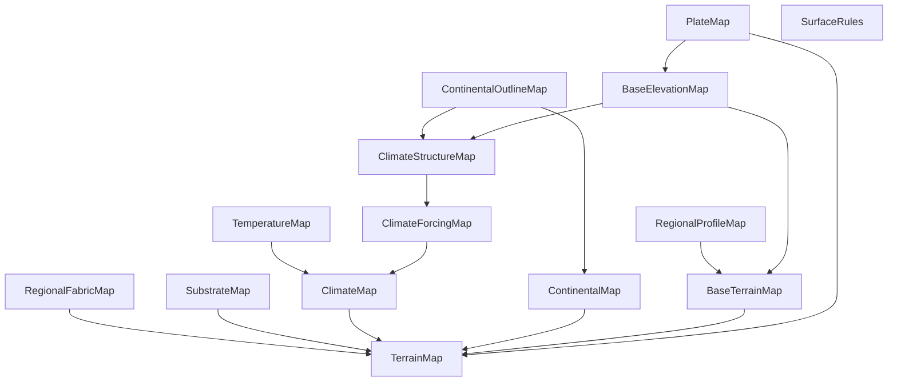
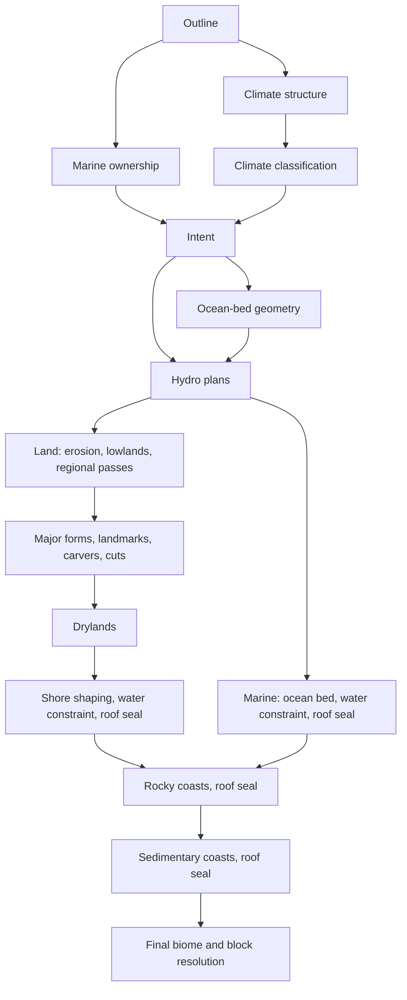

# Architecture

How Riven generates terrain (`TerrainMap.VERSION`, logged at startup). Feature details are in [FEATURES.md](FEATURES.md);
the runtime stack is in [RUNTIME.md](RUNTIME.md); version history is in
[CHANGELOG.md](../CHANGELOG.md).

## Determinism contract

Generated content is a pure function of the world seed, the packaged definitions
(`src/main/resources/riven-*.json`) and the world's layout scale (`WorldScale`, from the
generator options level.dat saves; blank means 1). Request order, thread count, cache state and eviction must
not change any result. Memos publish immutable decisions through atomic references; concurrent
misses may duplicate cold work but cannot produce different values. Memos with a `SharedBuild`
(every `CellMemo`, hydrology plans, sediment and rock decisions) give concurrent misses on one key
a single build, which publishes its value before it lets go of the key and first looks for the
value again, so a miss that raced a build ending finds the value instead of building it again.
In-build parallelism (drainage scans, network and plan builds) runs through `BuildPool` on the
host's bounded pool (Cubature's build pool in the game, a shared bounded pool in tools) or on the
calling thread, never the JVM's common pool; the caller always works its own loop, so a bounded
pool cannot deadlock on a single build. Cubature also prepares regional plans ahead of the
players through `ICubeGenerator.prepareRegion` ("Preparation within bounds" in DECISIONS.md):
`TerrainMap.prepareRegion` builds one hydrology owner cell's drainage networks and plan, then its
sediment and rock decisions, and declines once a memo would pass its headroom: a quarter of a
set-associative memo, half the drainage memo, or 10 MB x layout squared of networks. A `CellMemo`
keeps each cell in either of two slots and a miss replaces the older entry, so cells no longer read age out and
two cells sharing a slot do not rebuild each other on every read (with a fixed victim, two
continents' drainage networks did, and a 16 km check on seed 5 ran for hours). The terrain
atlas proves this per render: `tools/terrain_atlas.py render --verify` re-samples in reverse
order on a different thread count and requires an identical SHA-256 digest of every layer and
site decision. Samples are reused per thread, so each stage result registers with
`TerrainMap.Sample` where it is declared, by the phase that runs it, and every column clears the
stages it skips in one call; `tools/checks/SampleHistoryCheck` proves a reused sample equals a
fresh one.

Each definition carries a fingerprint that fresh instances record. Changing a definition, a
composition order, a tie-break or a loop order at a budget limit changes worlds and needs a fresh
instance.

## Entry points

| Path | Caller | What it samples |
| --- | --- | --- |
| `RivenWorldType.Generator.generateCube` | Cubature, native cubes | One `NativeColumns` entry per chunk column: `TerrainMap.sample` once per column, stored as `ColumnBlocks.runs`, read by every cube between the lowest soil and the reference top (Y 351); cubes wholly under the ground also read each 4x4x4 cell's depth biome from the entry |
| `RivenWorldType.Generator.generateColumn` | Cubature, biome arrays | The same `NativeColumns` entry's habitats |
| `createTerrainPreviewSampler` | Cubature DH provider | `TerrainMap.sample` per preview column, emitted as `ColumnBlocks.runs` |
| `ClimateBiomeProvider` | Minecraft biome queries | `surfaceHabitat`; spawn biomes exclude ocean, deep ocean, river, swamp and all three beach biomes |
| `RivenSpawn` | Forge `CreateSpawnPosition` | First dry land column, in 64-block rings out to 16,384 blocks, with a 16-block dry margin |
| `/riven` (`RivenCommand`, report in `ColumnReport`) | Player | All observations at the player's column |

Cubes entirely below the lowest possible soil are filled with stone directly unless an aquifer
intersects them; cubes above the highest possible surface are air. `NativeColumns` holds
resolved chunk columns in a set-associative cache (`nativeColumnCache` in `riven-terrain.json`,
1,024 entries, about 8 MB) of immutable entries, so a column is sampled once rather than once per
cube. Surface and water queries (`NativeColumns.surface` for tree sites' clearance,
`NativeColumns.water` for reeds beside water) read a held chunk column or resolve just their one
column, with a small per-thread cache, so distant previews do not build whole chunk columns for
them. Clearance only asks whether a column rises above a height (`NativeColumns.surfaceAbove`):
carving never raises a column's top, so the uncarved runs settle most answers and only the rest is
carved. `tools/checks/SurfaceQueryCheck` proves the queries equal the chunk column's and the bound
holds. `ColumnBlocks` holds the block rules over the `TerrainBlock` palette; `TerrainColumn`
maps it to Minecraft states. `tools/checks/ColumnRunsCheck` proves runs, per-Y resolution, the
cached cubes and cached habitats agree. Population is empty unless the optional Biomes O' Plenty
decoration provider is loaded (FEATURES.md, "Decoration provider"); its placements are the one
recorded exception to order independence.

## Map graph

`GenerationMaps` (one per seed, owned by `WorldGenerationContext`) builds every service once:

Dependencies run one way. Earlier services never read later ones; no service reads final
terrain to make a selection.

## Planning boundaries

`TerrainMap` exposes five boundaries. Planners read only the boundary their contract names;
they never call `surfaceHabitat` or final `sample`.

| Boundary | Available facts | Excluded |
| --- | --- | --- |
| `intent` | Outline, marine ownership and ocean water, climate, base terrain, shore intent | Local hydrology, all shaping |
| `habitat` | Intent plus local surface-water and lens plans | Final terrain, coastal emergence |
| `sampleBeforeMajorFeatures` | Habitat, erosion, lowlands, regional passes; constrained ocean bed on marine columns | Major forms, carvers, drylands, wonders, coastal formations |
| `sampleBeforeRocky` | Complete earlier surface with shore/water constraints and roof seal | Rocky and sedimentary formations |
| `sampleBeforeSediment` | The above plus rocky geometry and roof seal | Sedimentary formations |

Major-form certificates read `sampleBeforeMajorFeatures` on the shared site-certificate lattice
(every 8 blocks, world-aligned, since v56) over their support plus an anchor and halo, so a site
decision costs the same whatever resolution a native cube or a DH tile requests; rocky certificates read `sampleBeforeRocky`; sediment
certificates read `sampleBeforeSediment`. `surfaceHabitat` is for final biome consumers and runs
final shaping where a native coastal plan exists.

## Composition order

Land columns run, in order: erosion, lowlands, regional passes, volcanic, cold, plateaus,
mountains, hills (capped by the coastal envelope), regional landmarks, surface carvers, general surface cuts, drylands, wonders (rare set pieces, with voids), shore
shaping, hydrology constraint, rocky coasts, sedimentary coasts. Marine columns run ocean bed,
hydrology constraint and roof seal, then the coastal stages. This order is part of the generator
definition:

- `Sites` prevents major supports from stacking. Each winner is decided from seeded raw
  neighbors with a coordinate tie-break; rejected winners leave empty space.
- Lowland and dryland alternatives read one common parent within their stage; ocean ridge,
  trench and bank alternatives read the same shelf parent. These are compositions, not erosion
  simulations.
- Drylands read the applied major and cut results to attenuate their detail.
- Shore shaping precedes the hydrology constraint. Later coastal plans certify their parents and
  preserve water reservations; reapplying all constraints afterwards would change them.
- Roof sealing clips a lake (lens) interval conservatively; a later raised surface does not
  recreate removed water.
- After the geology column, each sample reads its flood cell (`FloodMap`), then its cave
  entrances. A flood cell's level comes from its center's sample up to the geology column, which
  reads neither flood cells nor caves, so no sample depends on itself.

Within `Hydro`, construction runs network and lake, supplemental basins, expanded coastal
decisions, lens, then river decisions, so rivers see completed coastal reservations. Sampling
applies the lens, network/lake/river, then basins; later bodies keep existing wet ownership.

`TerrainColumn` resolves blocks in this precedence: world bounds and bedrock, rocky solid/void
edits, earlier-parent delegation for rocky volumes, cave and lake fills, surface water and air,
then surface materials (`SurfaceRules`). DH runs use the same resolver. The native cube writer
then swaps rock blocks for content where the column says so: an ore body's ore first, else the
host rock's unstable stone on an unstable floor; the distant preview keeps the rock.

## Feature sites

`Sites` (configured in `riven-terrain.json`) places sparse major features on a 288-block cell
grid. Every cell is a raw anchor (`anchorProbability` 1.0, v42); a sequential lottery assigns its
lane (carver/cut 40%, hills 30%, mountains 15%, plateaus 7.5%, cold 3.75%, volcanic 1.9%, then
sediment, rocky and landmark under 1% each). With `competition` LANE (v42) an anchor is admitted
only if no higher-priority raw anchor of the same lane lies within twice that lane's radius;
supports of different lanes may overlap and compose in stage order. Since v52, mountain, plateau, volcanic and
cold neighbors veto only if their own anchor passes the stage's anchor-local admission
(earlier intent, climate, water and marine tests, memoized per cell); other raw neighbors veto
whether or not they would build. (SHARED, the rule until v41, also let every other lane veto within the
larger of the 518-block separation and the sum of both radii; it vetoed about 90% of anchors.) Per-lane maximum radii: carver, cut, hills,
landmark 259; rocky 256; plateau and volcanic 288; mountains 576; cold 816; sediment 1,088
blocks.

Each family's terrain adapter then certifies its admitted site against the earlier parent and
rejects it when the footprint fails, without rerolling. Mountains left the lanes at v62
(`laneDensity` MOUNTAINS 0): they follow continent crests instead (FEATURES.md).

## Measured structural limits

Terrain-v39, 64 km windows on seeds 8675309, 101, 1, 42, 7 and -991 (atlas and `intent` probes):

- Land (terrain-v58, outline probe on 64 seeds): 40.6% in 8 km worlds with per-continent variation
  (41-46% by family at v57, radius 1,350). Before that
  (terrain-v48, `LandSpread` probe on 64 seeds): 43-70% in 8 km worlds (mean 58%, sd 6,
  each family within 4 points), 54-62% in 32 km worlds. Continents use a 3,000-block lattice with
  radius 0.53 spacing and every cell occupied, so neighboring supports overlap and merge;
  landmasses reach about 8 km in an 8 km world and 25 km in a 32 km one. Bays cut only their own
  continent and never deepen sea. Ocean corridors run every 12 cells (36 km), shifted 6, so the
  nearest lines fall 18 km from the origin, outside a 32 km world.
- Every marine column holds water to Y62; enclosed marine areas are inland seas.
- Raising features no longer exclude the shore (v50): hills and the major features (volcanic,
  cold, plateaus, mountains) keep the coast with envelopes in `Shore`, and only water, marine
  anchors and marine footprints still exclude them. Cuts, lowlands and drylands keep the shore
  reservation (0.5 coastal-plain widths), since lowering near the sea could open dry basins.
  Since v52 a site competes only against same-lane anchors whose own earlier facts admit the
  feature (`Sites.admits` with an eligibility test, memoized per cell), mountain footprints may
  overhang the sea, and occurrence thinning is off for mountains, volcanoes and cold forms. On 4
  seeds an 8 km world builds 3.8 mountain ranges (0.3 at v51) and 13 plateaus; major features
  raise 1.3% of land (0.7%).
- Since v54 every lane draws its own anchor in every cell (`laneDensity` in
  `riven-terrain.json`, lane-salted keys), replacing the share cascade that left cold and volcanic
  lanes 3.8% and 1.9% of cells. Other lanes keep their earlier densities; cold and volcanic get
  0.15. Cold forms need only a cold, fit anchor (other columns fade), raising cold forms and
  volcanic cones may overhang the sea, and a volcano needs a HOT anchor and fades toward cooler columns (v55, user
  decision). On 4 seeds at v54 an 8 km world built 1.5 cold forms and 0.5 volcanoes (0 at v53),
  most volcanic candidates then failing the all-HOT footprint; v55 is unmeasured. Coastal
  formations still build none.
  Regional passes (about 47% of land) and shore shaping (22-24%) are the main active stages;
  drylands reach 2.0-2.4%, lowlands 1.4-1.5%.
- Median warm sample cost is 39 µs on land and 14 µs over ocean. Full-support certificates now
  run on many more sites: a cold site can cost about 0.2 s on the first sample that reaches it,
  and a 64 km atlas window takes 110-156 s on 16 threads. Native cubes read the `NativeColumns`
  cache; the smoke world reaches server `Done` in 4.6 s with full-view tick p95 81 ms.

The coast-first landforms decision ([DECISIONS.md](DECISIONS.md)) addresses these limits.

## Scratch and fractional queries

Callers own scratch `Sample` objects; never share one between simultaneous calls. `intent` and
`habitat` refresh only `BaseSample` facts. Fractional coordinates deliberately omit some
native-only formations, and alternate erosion-octave queries are diagnostic variants; neither
substitutes for the integer, canonical native/DH path when checking parity.

## Definitions

| File | Owner |
| --- | --- |
| `riven-terrain-height-reference.json` | Adopted height reference (`TerrainHeightReference`): datum, crust floor Y-512 and world floor Y-1664 (allocation to Y384), cloud base Y256 (`WorldType.getCloudHeight`), feature widths and elevations |
| `riven-realms.json` | The descent (`RealmMap`): the crust realms' depth biomes and what their caves hold; realms below the crust: bands, biomes, geology (zones, rock bodies, inclusions, seams) and open transitions with boundary rocks |
| `riven-subsurface-climate.json` | Temperature, humidity and air below the ground (`SubsurfaceClimate`); biome rules may test them |
| `riven-player-effects.json` | Player effects from the subsurface climate (`PlayerEffects`); gameplay, not generated content. Shipped defaults for the server option `config/riven/player-effects.json`, which the server reads instead |
| `riven-terrain.json` | Broad intent blends and `Sites` |
| `riven-continents.json` | Outline family, tuning, shelf and native water admission |
| `riven-base-elevation.json`, `riven-base-terrain.json`, `riven-terrain-regions.json` | Inland elevation, relief composition and regional profiles |
| `riven-regional-fabric.json`, `riven-climate-forcing.json`, `riven-substrate.json` | Earlier regional axis, moisture forcing, material permissions |
| `riven-terrain-passes.json`, `riven-landmarks.json`, `riven-surface-carvers.json` | Regional passes, landmarks, legacy carvers |
| `riven-lowlands.json`, `riven-hills.json`, `riven-mountains.json`, `riven-plateaus.json`, `riven-drylands.json`, `riven-cold-regions.json`, `riven-volcanic.json`, `riven-general-surface-cuts.json` | Contributed land families |
| `riven-shores.json`, `riven-ocean-floors.json`, `riven-rocky-coasts.json`, `riven-sedimentary-coasts.json`, `riven-estuaries.json` | Coast and seabed |
| `riven-hydrology.json`, `riven-lakes.json`, `riven-rivers.json` | Water |
| `riven-habitats.json`, `riven-surface-rules.json` | Biome palettes and block materials |
